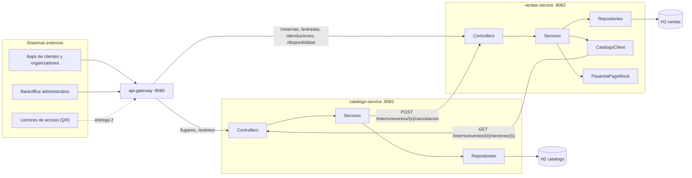

# TicketYa - Arquitectura de microservicios

## 1. Microservicios y responsabilidades

| Servicio | Puerto | Responsabilidad | Base de datos |
|---|---|---|---|
| **api-gateway** | 8080 | Punto de entrada único. Enruta a los servicios, asigna un `X-Correlation-Id` a cada pedido y registra método, ruta, usuario, código de respuesta y tiempo. No publica las rutas `/interno/**`. | - |
| **catalogo-service** | 8081 | Lugares, sectores y eventos: alta, precios por sector, publicación, suspensión, cancelación y búsqueda por múltiples criterios. Es el dueño de la verdad sobre qué se vende y a qué precio. | H2 `catalogo` |
| **ventas-service** | 8082 | Reserva temporal de lugares, compra y pago (pasarela simulada), entradas con QR, devoluciones y cancelación de entradas. Garantiza que una entrada no se venda dos veces. | H2 `ventas` |

**Por qué esta división:** catálogo se lee mucho y cambia poco (candidato a caché en la entrega 2), mientras que ventas
recibe mucha escritura concurrente sobre los mismos recursos. Separarlos permite escalar y proteger ventas de forma
independiente, y deja un lugar natural para sumar servicios en la entrega 2 (notificaciones, fila virtual,
recomendaciones y reportes).

Cada servicio tiene su propia base de datos y **no accede a la del otro**: lo que necesita lo pide por HTTP.

## 2. Diagrama de módulos

## 3. API pública (a través del gateway, `http://localhost:8080`)

| Servicio | Endpoints |
|---|---|
| catalogo | `POST/GET /lugares`, `GET /lugares/{id}`, `POST/GET /eventos`, `GET /eventos/{id}`, `PUT /eventos/{id}/precios`, `POST /eventos/{id}/publicacion`, `PUT /eventos/{id}/suspension`, `PUT /eventos/{id}/cancelacion` |
| ventas | `POST /reservas`, `GET/DELETE /reservas/{id}`, `POST /reservas/{id}/pago`, `GET /entradas`, `GET /entradas/{id}`, `POST/GET /devoluciones`, `PUT /devoluciones/{id}/aprobacion`, `PUT /devoluciones/{id}/rechazo`, `GET /disponibilidad/eventos/{e}/sectores/{s}` |

Detalle con ejemplos en [05-api-endpoints.md](05-api-endpoints.md) y en los OpenAPI de cada servicio.

**API interna** (solo entre servicios, el gateway no la publica):

| Quién llama | Endpoint | Para qué |
|---|---|---|
| ventas -> catalogo | `GET /interno/eventos/{eventoId}/sectores/{sectorId}` | Obtener estado del evento, fecha, capacidad y precio del sector. |
| catalogo -> ventas | `POST /interno/eventos/{eventoId}/cancelacion` | Avisar la cancelación para pasar las entradas a reintegro. |

## 4. Cómo se garantiza que una entrada no se venda dos veces

El control está **en la base de datos**, no en la memoria de una instancia. Por eso funciona aunque haya varias
instancias de ventas ejecutándose al mismo tiempo.

| Caso | Mecanismo |
|---|---|
| **Asiento numerado** | Restricción de unicidad sobre `(evento, sector, fila, número)` en `asiento_ocupado`. Si dos clientes intentan tomar el mismo asiento, la base rechaza al segundo y su transacción se deshace por completo. |
| **Zona sin asiento (cupo)** | Una fila de cupo por zona (`stock_zona`) que se modifica con bloqueo pesimista (`SELECT ... FOR UPDATE`): las compras esperan su turno y el cupo no puede quedar negativo. Es la alternativa "pesimista" indicada para mucha competencia por el mismo cupo. |
| **Reintento del cliente** | Cada pago lleva un `Idempotency-Key` único guardado con restricción de unicidad. Repetir el pago devuelve el resultado anterior sin cobrar otra vez. |
| **Pago en curso** | Al comenzar el cobro la reserva pasa a `EN_PAGO`: mientras tanto nadie puede liberar sus lugares aunque su plazo esté por vencer. |
| **Reservas vencidas** | Se liberan al reservar (los lugares de reservas vencidas más de 5 segundos). No hace falta un proceso aparte. |

Esto se prueba con tests que lanzan **20 clientes simultáneos** sobre el mismo asiento y sobre el último lugar de una zona
(`DobleVentaTest`).

## 5. Consistencia entre servicios (entrega 1)

Una cancelación de evento involucra a los dos servicios, y no existe una transacción de base de datos que los abarque:

1. Catálogo cambia el estado del evento a CANCELADO y **confirma su transacción**.
2. Recién después avisa a ventas por HTTP (**fuera de la transacción**, con timeouts de conexión y de lectura).
3. Ventas pasa las entradas a `A_REINTEGRAR` en **una única transacción**, de forma idempotente.
4. Si ventas no responde, el evento igual queda cancelado y la respuesta devuelve `reintegroNotificado: false`.

Lo mismo se aplica al pago: la llamada a la pasarela se hace **fuera** de toda transacción de base de datos, para no
mantener conexiones ni bloqueos tomados mientras se espera a un sistema externo. Las compensaciones automáticas (Saga),
los reintentos programados y el circuit breaker se completan en la entrega 2.

## 6. Decisiones y simplificaciones de la entrega 1

| Tema | Decisión |
|---|---|
| Autenticación | Sin JWT: el cliente va en `X-Usuario-Id` y el administrador en `X-Rol: ADMIN`. (JWT en la entrega 2) |
| Pasarela de pagos | Simulada (`PasarelaPagoMock`): rechaza los medios de pago cuyo nombre contiene "RECHAZ" y aprueba el resto. |
| Bases de datos | Una base H2 en archivo por servicio, esquemas separados. (MongoDB y otras tecnologías en la entrega 2) |
| Reserva temporal | Vence a los 10 minutos (`ventas.reserva-minutos`). Máximo 4 entradas por cliente y evento (`ventas.max-entradas-por-evento`). |
| Orden por relevancia | No implementado (se sumará con las recomendaciones). Se puede ordenar por fecha o por precio. |
| Despliegue | Ejecución local de cada servicio. (Docker y docker-compose en la entrega 2) |

## 7. Limitaciones conocidas

- Si el servicio de ventas se cae justo mientras una reserva está `EN_PAGO`, la reserva queda en ese estado hasta que se
  resuelva manualmente. La entrega 2 lo resuelve con compensaciones.
- Si el pago ya se aprobó cuando se cancela el evento, la entrada se emite directamente en `A_REINTEGRAR` (hay una marca de
  evento cancelado para cubrir ese caso). Queda una ventana de milisegundos que también cubre la entrega 2.
- Si catálogo no logra avisar la cancelación a ventas, el aviso no se reintenta automáticamente todavía.
- Las llamadas entre servicios usan direcciones fijas (`localhost`); service discovery queda para la entrega 2.

## 8. Requisitos no funcionales y su entrega

| Requisito | Entrega |
|---|---|
| Arquitectura de microservicios Spring Boot independientes | E1 |
| API Gateway como punto de entrada único | E1 |
| API REST síncrona | E1 |
| Una base de datos por servicio | E1 |
| Concurrencia e idempotencia (doble venta) | E1 |
| Trazabilidad: registro de cada solicitud y `X-Correlation-Id` | E1 (parcial en el gateway), E2 (log centralizado) |
| Seguridad con JWT y roles | E2 |
| Base NoSQL en al menos un servicio | E2 |
| Consistencia entre servicios y compensaciones | E2 |
| Resiliencia: reintentos, timeouts y fallback | E1 (timeouts), E2 (reintentos y fallback) |
| Caché de catálogo (y por qué no se cachea la disponibilidad) | E2 |
| Docker y docker-compose | E2 |
| Prueba de carga | E2 |
