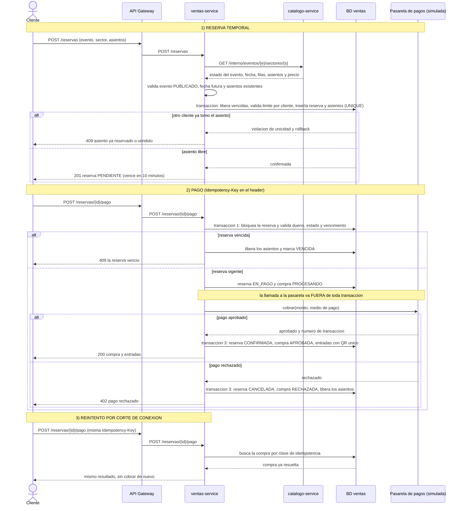

# Diagrama de secuencia: compra de una entrada numerada

Flujo completo de la compra de un asiento numerado, incluyendo los casos en que **otro cliente ya tomó el asiento**,
**el pago es rechazado** y **la reserva vence**.

## Qué pasa en cada caso

| Situación | Resultado | Estado final |
|---|---|---|
| Asiento libre y pago aprobado | 201 y luego 200, entradas emitidas | Reserva `CONFIRMADA`, compra `APROBADA`, entradas `VENDIDA` |
| Otro cliente ya tomó el asiento | 409 en la reserva | No se crea nada (rollback) |
| Pago rechazado | 402 | Reserva `CANCELADA`, compra `RECHAZADA`, asiento libre |
| Reserva vencida sin pagar | 409 al pagar | Reserva `VENCIDA`, asiento libre |
| Reintento con la misma clave | Mismo resultado | Sin cobro duplicado ni entradas duplicadas |
| Catálogo no responde | 503 en la reserva | No se crea nada |
