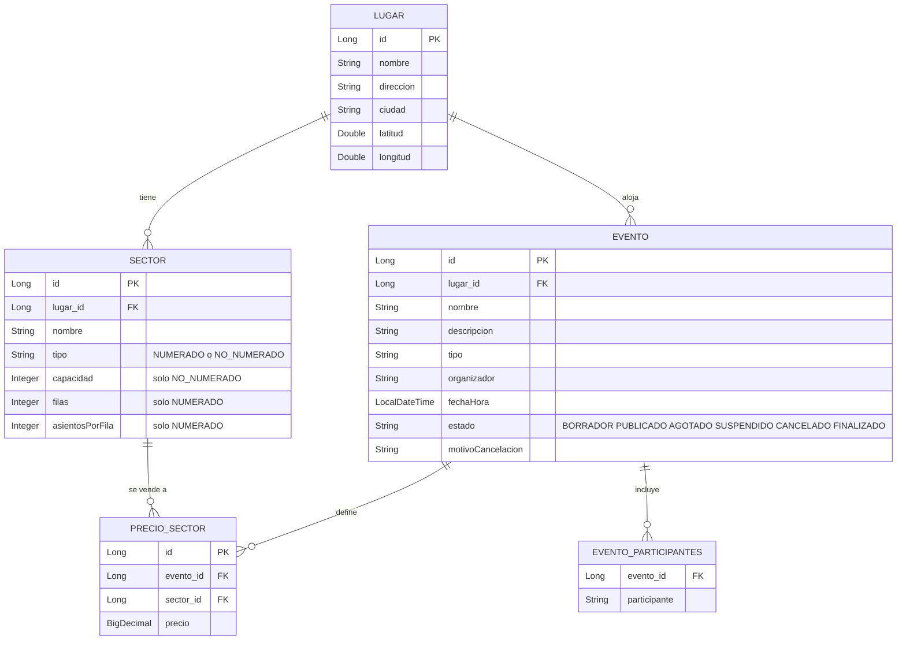
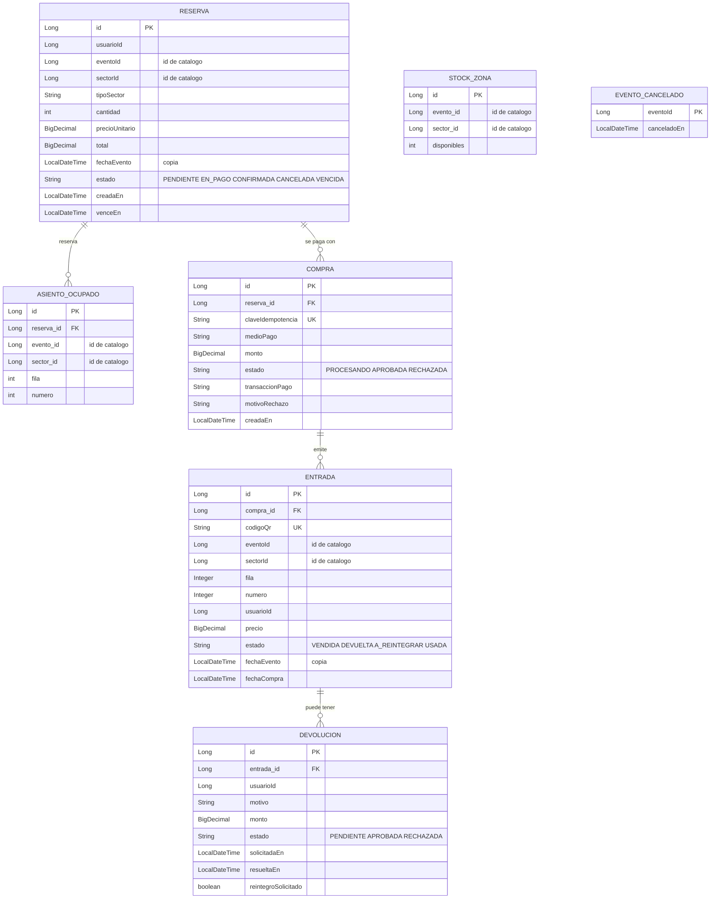

# Modelo de datos por microservicio

Cada servicio tiene su propia base de datos. Las relaciones **dentro** de un servicio son claves foráneas; las relaciones
**entre** servicios se guardan solo como el id del otro servicio, sin clave foránea (no se puede cruzar de una base a otra).

## catalogo-service

Restricción de unicidad: `PRECIO_SECTOR (evento_id, sector_id)` (un solo precio por sector en cada evento).

## ventas-service

Restricciones de unicidad que sostienen la garantía de no doble venta:

- `ASIENTO_OCUPADO (evento_id, sector_id, fila, numero)`: un asiento solo puede estar ocupado una vez.
- `STOCK_ZONA (evento_id, sector_id)`: una sola fila de cupo por zona (se modifica con bloqueo pesimista).
- `COMPRA (clave_idempotencia)`: un intento de pago por clave.
- `ENTRADA (codigo_qr)`: cada código QR es único.

## Relaciones entre servicios y entidades solapadas

| Dato en ventas | Referencia a catalogo | Cómo se resuelve |
|---|---|---|
| `evento_id`, `sector_id` (en reserva, asiento, stock y entrada) | `EVENTO.id`, `SECTOR.id` | Solo el id, sin clave foránea. Los datos del evento y del sector se piden por HTTP al reservar. |

**Entidades solapadas entre bases:** ninguna entidad está duplicada. `Evento`, `Lugar` y `Sector` existen **únicamente**
en catálogo. Ventas guarda además **copias de valores puntuales** que necesita después, para no depender de catálogo:

| Copia en ventas | Origen | Motivo |
|---|---|---|
| `fechaEvento` (reserva y entrada) | `EVENTO.fechaHora` | Aplicar la regla de 72 horas de las devoluciones sin consultar a catálogo. |
| `precioUnitario` y `precio` | `PRECIO_SECTOR.precio` | Congelar el precio al momento de la compra: lo pagado no cambia si el organizador cambia la tarifa. |
| `tipoSector` | `SECTOR.tipo` | Saber cómo liberar los lugares (asientos o cupo) sin consultar a catálogo. |
